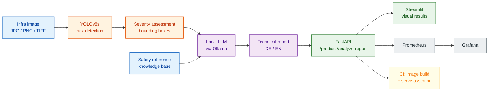
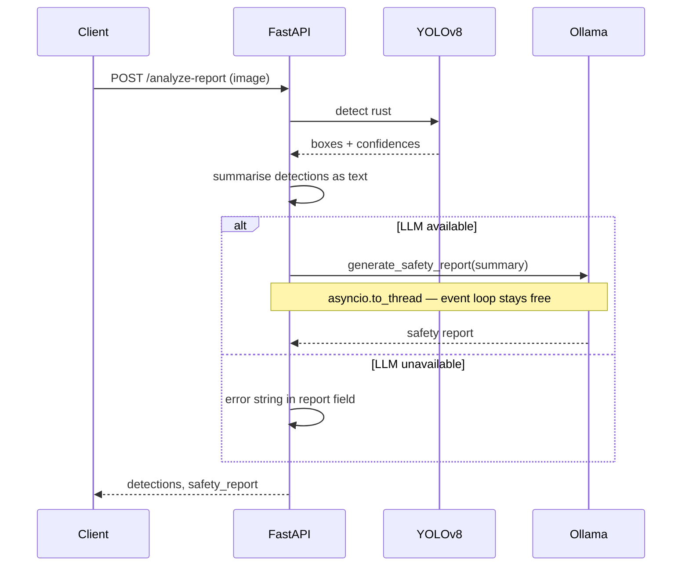

# InfraLens: Industrial Rust Detection System


**InfraLens** is an automated computer vision system for industrial safety. It detects corrosion on infrastructure using a custom-trained **YOLOv8** model and employs a **Generative AI agent (a local LLM via Ollama)** to draft technical safety reports in German/English compliant with ISO standards.

---

**At a glance** — mAP50 **0.399** · 162 unit tests · 13 CI jobs · YOLOv8s + shadow A/B + local LLM reports

### What it does

- **Custom Vision:** YOLOv8 model (`rust_v8s_best.pt`) for surface-defect detection.
- **AI Safety Consultant:** Local LLM agent (via Ollama, model configurable) with template-based fallback for automated report generation and recommendations.
- **Microservices Architecture:** Containerized Backend (FastAPI), Frontend (Streamlit), and AI Engine.
- **Deployment:** Docker Compose for local development and Kubernetes manifests in `k8s/` for production.
- **Full CI/CD:** GitHub Actions for automated testing, building, and deployment.
- **Edge AI Ready:** Optimized for NVIDIA GPU passthrough on edge devices and K8s clusters.
- **Multi-language Reports:** Generates technical reports in German and English per ISO standards.

### Architecture


The LLM call takes roughly 52 seconds on CPU. It runs in a worker thread so it
cannot stall the event loop — before that fix, a health check issued during a
report waited 7.6 seconds, which is long enough for a Kubernetes liveness probe
to kill the pod.



### Verified results

Reproduced locally on an NVIDIA RTX 3050 Ti (4 GB) with Ultralytics 8.4.

| Metric | Value |
|--------|-------|
| Dataset | [Rust Detection v1](https://universe.roboflow.com/nishat-workspace/rust-detection-6ogya-rl87b/dataset/1) (Roboflow, CC BY 4.0) |
| Images | 40 train / 15 valid / 15 test |
| Base model | YOLOv8s (detection) |
| Epochs | 40 (GPU) |
| Precision | 1.00 |
| Recall | 0.294 |
| **mAP50** | **0.399** |
| mAP50-95 | 0.259 |
The dataset is deliberately small (40 training images), so recall and mAP are
low. This is a data-volume limitation, not a pipeline defect. The reported
precision of 1.00 with 0.294 recall means the model is conservative — it only
flags corrosion it is confident about. Scaling to a few hundred annotated
images is the single highest-value next step.

### Why this matters in Germany

| Standard / driver | How it applies |
|---|---|
| **DIN EN ISO 12944** | Severity assessment aligns with German corrosion-protection grading for steel structures |
| **DGUV Vorschrift 3** | Real-time safety monitoring supports accident-prevention requirements |
| **TÜV / DIBt** | Report format supports documentation for inspection and component-catalogue requirements |
| **Mittelstand** | Edge deployment avoids a cloud dependency small firms cannot fund |
| **Energiewende** | Pipeline and wind-turbine inspection |

### API

All endpoints except `/` and `/metrics` require `X-API-Key`. Full payloads: [docs/OPERATIONS.md](./docs/OPERATIONS.md).

| Method | Path | Limit | Purpose |
|--------|------|-------|---------|
| `GET` | `/` | none | Health: `model_loaded`, `auth_enabled` |
| `POST` | `/predict` | 60/min | Image in, rust detections out |
| `POST` | `/predict-ab` | 60/min | Champion vs shadow on the same image; `503` unless `SHADOW_MODEL_PATH` is set |
| `POST` | `/analyze-report` | 30/min | Detections + LLM safety report (off the event loop) |
| `GET` | `/drift` | 30/min | Drift state for detection inputs |
| `POST` | `/admin/reload-model` | 5/min | Reload without a restart |
| `GET` | `/metrics` | none | Prometheus exposition |


### Quickstart

```bash
uv sync --extra dev
uv run python src/scripts/train_yolo.py     # needs the Roboflow export
uv run uvicorn src.app.main:app --port 8001
curl -X POST http://localhost:8001/predict \
     -H "X-API-Key: demo-secret-key" -F "file=@rust.jpg"
```

Dataset setup, training flags and troubleshooting: **[docs/OPERATIONS.md](./docs/OPERATIONS.md)**.

### Stack

| Service | Port | | Service | Port |
|---|---|---|---|---|
| FastAPI | 8001 | | Prometheus | 9091 |
| Streamlit UI | 8502 | | Grafana | 3002 |
| MLflow | 5002 | | MinIO | 9002 |
| TLS proxy | 8444 | | | |


Run this project alone with `./run_stack.sh` (API, MLflow, MinIO, Prometheus, Grafana). Dashboard: `streamlit run src/app/ui.py` (port 8502). Airflow and the Postgres feature store run through `docker compose`. The four-project orchestrator used during development is kept in the author's workspace and is not part of this repository.

### Security

| Control | Implementation |
|---|---|
| Auth | `X-API-Key` via `secrets.compare_digest` (constant-time) |
| TLS | nginx reverse proxy, TLSv1.2/1.3 |
| Upload limits | `Content-Length` rejected before the body is read |
| Rate limits | Per-endpoint, 429 on breach |

**Not in place:** RBAC, a secret manager, multi-node HA, a soak test. The
systems are *production-shaped*, not production-grade.

### Tests and CI

| | |
|---|---|
| Unit tests | **162** (8 integration tests run against the live stack) |
| CI jobs | **13**: 3.10 + 3.11 matrix, ruff, mypy, Bandit, pip-audit, Trivy SARIF, Terraform validate, Docker build-and-serve, Helm deploy to kind, README-count check |

## Roadmap

1. **More annotated data.** Training used 40 images and gives recall 0.294 at
   precision 1.00. Annotating a few hundred images is the highest-value change,
   scored on the same test split.
2. **Ground the safety reports.** The LLM report summarises the detections but
   is not checked against them. Apply the number-grounding check used in
   AeroPredict, so a report cannot cite a count the detector did not find.
3. **Run the retraining DAG end to end**, as with the other projects.
4. **Measure edge deployment.** Latency and memory have been measured on the
   development laptop. Measure them on the target edge GPU before quoting them.

---

**Author** — Khaled Saifullah · [GitHub](https://github.com/ksnishat)
